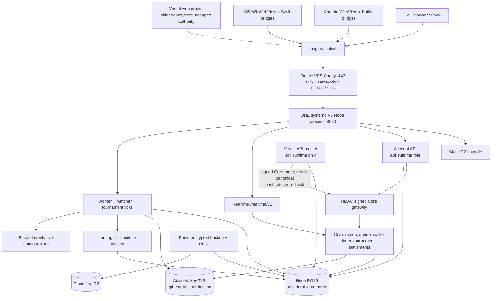
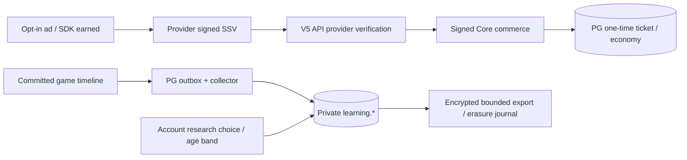

# Mega XOXO V5.2 — High-Level and Low-Level Architecture, Production Risks, Capacity Roadmap

**Reviewed:** 2026-10-16. **Snapshot:** `V5.2` @ `1bbed3669dd9fee1ce7af9d7a699fed0d728456a`. **Audit method:** read-only GitHub/CI logs, Vercel projects/domains/deployments, repo source and dated live deployment receipts. No production writes or load tests. Direct live HTTP probes were DNS-blocked from the audit environment; October 15 live HTTPS receipts are cited, not presented as October 16 confirmation. Reconcile exact SHA once Main merges the pending PRs.

## Executive assessment

**Retain the Node/Caddy/PostgreSQL/Valkey design for now.** The system already has a sound single-writer ledger, HMAC-signed Core commands, role-separated PostgreSQL pools, transaction-idempotent state transitions, isolated staging, backup recovery and physical native builds. The urgent issues are release/configuration correctness, incomplete provider integration, observed API latency, and the operational failure domain of a single production Node process. **Additional P0 source-level risk:** `deploy/compose.yaml` still defines the old V4 SQLite `app` with `restart: unless-stopped` and makes the Caddy `edge` depend on `app: service_healthy`. The cutover only set the *existing container* restart policy to `no`. A future `docker compose up`/edge re-creation could bring the fenced V4 writer back or block edge startup. This is a potential runbook hazard, **not proof that V4 is presently running**. Create a separate edge-only V5 Compose/service configuration and test the dependency graph offline; do not execute the old Compose file against production. Docker's dependency semantics are documented at https://docs.docker.com/compose/how-tos/startup-order. The submitted Rust reel's 14k→64k sockets is not proof of 4.57x throughput for this turn-based game.

**Reliability verdict:** early beta has a real authoritative V5 PostgreSQL backend; production does **not** yet have demonstrated host high availability or workload-based capacity limits. **Native/distribution verdict:** development builds launched on Android/iPhone; store approval of actual binaries and live AdMob earned callbacks remain unproven. **Data verdict:** consent functions tested, but research production enablement, withdrawals and backup prune must be verified live.

## 1. HLD — actual production authorities



**Important separation:** the API, Core and worker use distinct database *credentials* and software boundaries but currently live in **one OS process** (`scripts/v51/v5-production-server.cjs`). The Vercel API is an optional second public **control-plane reader**, not an independent game writer. The main game must remain same-origin because the host-only `__Host-mega_session` cookie and relative `/api` and `/realtime/v1` paths do not automatically follow to an API subdomain.

### Production evidence

| Plane | Source and observed state | Limit or uncertainty |
| --- | --- | --- |
| Canonical ingress | `deploy/Caddyfile`; Oracle/Caddy apex, retired play.antimatter host 308 redirect, www 301; public 31/31 two-user checks on Oct15 | Live reviewer DNS unable to confirm Oct16 response. |
| Game server | `scripts/v51/v5-production-server.cjs` `main()` composes Node HTTP, API/Core, WS, worker and matchmaker | Single process/host outage affects all. |
| Authority | Neon production PG16, 55 migrations; 2026-10-15 authority epoch `v5:1792037113917:153a8543d555682d` | V4 SQLite writer fenced; **PG forward-recovery only** after first V5 write. |
| Redis | Aiven/Valkey over TLS, environment-isolated `prd` ephemeral namespace | Inventory and cutover receipts name different service identifiers; verify without modifying. |
| Backups | R2 encrypted uploads every 5 minutes, independent restore/PITR and delivered failure/recovery alert evidence | Backup privacy journal / 35-day prune was `pruneReady:false`; recheck. |
| Vercel | Both `megaxo.online` and `api.megaxo.online` registered to projects; API deployed READY and PG pooled | Oracle is the canonical entry. Project attachment is not DNS serving proof; API signed Core route may still use retired hostname. Vercel Hobby commercial restrictions apply if monetizing. |
| Provider | PR #18 sign-in/iOS, PR #19 Cashfree open at audit | Live provider config, SSV, IAP and web settlement not end-to-end accepted. |

## 2. LLD — modules, boundaries and data ownership

| Component | Code | Actual responsibilities / performance knobs |
| --- | --- | --- |
| Edge/TLS | `deploy/Caddyfile`; V4-era `deploy/compose.yaml` | compress zstd/gzip, reject private operator paths, route body-limited same-origin requests to `172.18.0.1:8080`; `core.megaxo.online` /ingress currently documented as staging. Do not remove Caddy without preserving security/TLS behavior. **Edge currently inherits an unsafe historical Compose dependency on the old V4 `app`; do not use that file to manage current production.** |
| Composition | `scripts/v51/v5-production-server.cjs` | Validates secret files, production target/epoch, pool roles, managed Redis; creates Node HTTP server, realtime transport, worker ticks and matcher. **Global header `X-Robots-Tag: noindex, nofollow` at line ~722 requires live SEO check.** |
| API | `apps/api/index.js`, `routes/{account,competitive,social,compat}.js`, `middleware/{cors,csrf}.js` | Session actor and CSRF; native bearer identity; API pool `api_runtime`, no Core economy DML, signed command forward. Release tests currently expect retired host. |
| Core and gateway | `packages/services/{core,core-gateway,queue,tournaments,timers}.js` | Server-authoritative moves, revisions, timeouts, matchmaking, Crowns/Coins, wallet and settlement. Signed command envelope, Core-only PG role and idempotent operation keys. |
| WebSockets | `packages/services/realtime-transport.js` / `apps/game-core/realtime.js` | Authenticated `/realtime/v1` upgrade using one-use ticket, membership check, event fan-out, snapshot fallback/reconnect. Measure live socket RSS, frame sizes, slow-client queues and repeated ticket DB reads. |
| PostgreSQL | `packages/db/pg/pool.js`, `migrations/manifest.json` | TLS + guarded pg.Pool; role/GUC/privilege checks per checkout, transactions. Production composition defaults max API6/Core6/worker2, inventory cap API16/Core8/worker4, timeout checkout15s/statement30s. Actual host values and query time must be sampled. |
| Redis/Valkey | `packages/services/{ephemera,managed-ephemera}.js` | Rate/coordination/leases/cache namespace, TLS, failures must fail safely without becoming a durable writer. |
| Worker | `packages/services/{worker-workflows,jobs,maintenance-scheduler}.js` | PG durable outbox, OTP mail, cleanup, monitoring, research sweeps. Currently composed into same process; worker interval 5s. Matchmaker ticks every 3s and processes up to 4 per mode/tick. |
| Read cache | `packages/services/read-cache.js` | Explicit private-no-store vs public projected TTLs; confirm real routes use the policy. Never shared-cache wallets, authentication or actor-private state. |
| Gameplay research | `packages/learning/{capture,worker,policy,privacy,exporter}.js` | Canonical move source/revisions, consent, age gating, encrypted export and deletion journal. A migration + test is not a production opt-in/corpus proof. |
| Native | `native/android`, `native/ios`, `src/game.js`, `src/powers-ui.js` | Client-bundled deterministic board and Bot inference; Kotlin/Swift device identity, billing/ad bridges. Live rewarded ad still not demonstrated. |
| Recovery | `deploy/v5/*backup*`, `/p15`, Neon PITR | 5-min R2 encrypted backup, readback and isolated restore. Never reactivate pre-cutover SQLite data. |

### 2.1 Authoritative turn transaction

```mermaid
sequenceDiagram
    participant U as Browser / Native
    participant E as Caddy + Node
    participant A as API api_runtime
    participant G as HMAC Core ingress
    participant C as Game Core core_runtime
    participant R as Valkey
    participant P as Neon PG
    U->>E: Session or native bearer; turn + idempotency key
    E->>A: Verify session / CSRF or native audience
    A->>G: Body-signed actor command
    G->>C: Validate actor, match membership, legal board, revision, deadline
    C->>R: Optional short-lived lease
    C->>P: BEGIN; CAS revision; durable ledger/outbox
    P-->>C: Commit once
    C-->>E: Authoritative revision + outcome
    E-->>U: Ack + subscribed WS event
    U->>E: Reconnect / snapshot if gap
    E->>P: Membership-checked authoritative snapshot
    E-->>U: Canonical state
```

**Invariants:** retry never double-spends a Crown, duplicates a match, yields a stale revision or grants a phantom Undo. Worker and Redis losses must not erase durable outcomes.

### 2.2 Reward/SSV and capture flows (NOT YET LIVE-VERIFIED)



At audited HEAD `apps/api` does not mount the V5 `/api/monetization/*` path despite Core `packages/services/commerce.js` implementation. **PR #19 changes old `server/monetization-http.js`, `server/monetization-store.js` and `server/production/*` SQLite/V4 code, not this PG Core; its own Oct16 handoff lists the required new V5 routes/migration/gateway.** Merging legacy code cannot be treated as live payment acceptance. Keep provider transactions fail-closed and no extra writer.

## 3. The $12 Rust/`io_uring` reel versus this workload

The owner's narration cites 14,000 → 64,000 simultaneous **connections**, reported p99 >200ms for five minutes and ~65k conntrack limit. We did not reproduce the original benchmark or know its request pattern, so **do not extrapolate** to 64k authenticated active Mega XOXO turns or 64k requests/s.

- **Transferable:** reuse buffers and reduce per-connection overhead under proven socket-bound load; Linux `io_uring` multishot accept/receive and provided rings are real kernel techniques, documented at https://man7.org/linux/man-pages/man7/io_uring_multishot.7.html and https://man7.org/linux/man-pages/man7/io_uring_provided_buffers.7.html.
- **Conditional:** `nf_conntrack_count/max`, file descriptors, process memory/socket, Caddy backlog and WS fan-out can cap concurrent sockets; measure before tuning (https://docs.kernel.org/networking/nf_conntrack-sysctl.html).
- **Not transferable as written:** benchmark batching **SQLite** does not apply to the new authoritative **remote PG16** ledger. Removing TLS proxy, auth, ORM and all async frameworks changes functionality and risk; in-game money and idempotency must remain correct.
- **Maybe later:** a Rust transport gateway that retains Caddy/TLS and delegates authority to the existing Core could be A/B tested on **identical realistic** game workloads. Do not rebuild economic/auth semantics in Rust for speculative speed.

## 4. Ranked optimization plan

| Rank | Pri | Recommendation | Estimated leverage / complexity | Objective proof |
| ---: | --- | --- | --- | --- |
| 1 | P0 | Repair exact-head domain/CSRF/iOS bundle CI and require green checks before new release | High / low | All workflows green on exact merged SHA, no weakening of 403 or domain enforcement. |
| 2 | P0 | Fix authority config source-of-truth drift (host `nonserving:false` versus repo `true`) | Very high / medium | Repeated immutable deploy does not overwrite runtime epoch or cause 502; rollback and recovery rehearsed. |
| **2A** | **P0** | **Retire V4 Compose auto-start dependency:** legacy `app` still `restart: unless-stopped` and `edge.depends_on.app`. Introduce V5 edge-only Compose, validate offline that an edge rebuild cannot start V4, and preserve the archived V4 definition only for explicit isolated recovery. | Very high data-authority safety / low–medium | No deployment command can recreate V4 writer or depend on its health; static dependency tests and release-runbook check. |
| 3 | P0 | Verify live production `noindex` and preserve only private/staging noindex | High discovery / low | External header/canonical/robots/sitemap checks; public SEO intentional, private not indexed. |
| 4 | P0 | Finish provider sign-in + V5 PG/Core monetization routes; never resurrect V4 SQLite for Cashfree | Very high correctness / medium-high | Browser+both phones share permanent actor, provider signatures and once-only grants; disabled until acceptance. |
| 5 | P0 | Prove production consent/capture, 35-day backup pruning and rollback journal; align data region/purpose | Very high trust / medium | Real verified adult/youth choices, withdrawal/export and restore, retention/prune with current policy/region. |
| 6 | P1 | Instrument route/network/PG/Redis/Node event-loop/WS before any large rewrite | Very high insight / low-medium | p50/p95/p99, RPS, active rooms, socket RSS, per-role waits, network RTT, errors by segment. |
| 7 | P1 | Diagnose observed ~0.8-1.4s real-device API timings and possible cross-region RTT | High potential / medium | Measured before/after latency; don't relocate Neon, Oracle or Aiven without migration proof/cost approval. |
| 8 | P1 | Separate outbox/retention/matchmaker workers from the main gameplay event loop | High robustness / medium-high | PG leases/idempotent ownership, HTTP/WS unaffected by blocked worker; no duplicate timers/wallet. |
| 9 | P1 | WS connection admission, bounded outbound queue, heartbeat, snapshot/traffic minimization | High at scale / medium | Slow-reader soak and reconnect with flat bounded RSS/socket and safe overload. |
| 10 | P2 | Same-origin static asset offload + immutable caching, with private API/WS untouched | Medium / medium | Lower static TTFB/Node CPU; no cache mixing, WebView asset or service-worker breakage. |
| 11 | P2 | Tune proven costly PG query plans, batch independent outbox/capture jobs transactionally | Conditional / medium | EXPLAIN on seeded data, lower PG query time; invariant tests and retries. |
| 12 | P2 | Activate Core A/B same-host failover, eventually independent-host HA | High resilience / high | SIGKILL/timer/epoch/replay proof; no extra paid host without owner consent. |
| 13 | P3 spike | Prototype Rust/`io_uring` connection sidecar only if transport CPU/memory truly dominant | Unproven / very high | Same TLS/auth/Core/PG/WS contract, identical load/error/p99 metrics, no better claims from synthetic idle sockets. |

### Safe performance experiment design

Use a **disposable PostgreSQL 16 + Valkey** test stack, not player accounts or live wallets. Test distinct families: idle signed WebSocket connections; authenticated account REST reads; casual/ranked queue; concurrent legal turns and snapshot recovery; refund/SSV retries and wallet exactly-once; worker stall and Redis restart. Ramp conservatively (proposed 50 → 100 → 250 → 500 → 1000 connections **only if resource budgets permit**) and repeat each rung three times. Never infer active-match throughput from the idle socket test.

Report independently: concurrent WS, active matches, move/s, authenticated HTTP RPS, p50/p95/p99 turn ack, PG pool acquire time, Redis RTT, Core timer drift, Node GC/event-loop lag, CPU/RSS/socket, open FD count, `nf_conntrack_count/max`, refusal/reconnect rate and missed settlements. Stop on protocol/economic/privacy violation, unsafe resource growth, provider quotas or >pre-registered error/latency budgets. No production stress test without separate authorization.

**Rust go/no-go:** only after at least two comparable baseline profiles identify network/WS bookkeeping as the dominant cost, and an isolated Rust prototype improves capacity/latency *at equal correctness and protection*, with operational effort worth the gain. Keep Caddy and PostgreSQL during the pilot.

## 5. Reference evidence and constraints

- Live authority/fence: `docs/v5.2/release/{CUTOVER-EVENT-20261015,FINAL-REPORT-V52-20261015,DOMAIN-CUTOVER-MEGAXO-ONLINE-20261015}.md`.
- Source: `deploy/Caddyfile`, `scripts/v51/v5-production-server.cjs`, `apps/api/index.js`, `packages/db/pg/pool.js`, `packages/services/{core,core-gateway,realtime-transport,read-cache,worker-workflows}.js`, `docs/v5/environments/{production,redis-production}.json`.
- P16 and load: `docs/v5.2/release/BACKEND-AND-RELIABILITY-AUDIT-20261015.md` (99/100 passed, 1 Docker-only skip, **not** a 64k benchmark).
- Native, privacy, provider: `DEVICE-TEST-REPORT-20261015.md`, `CONSENT-ACCOUNT-LANE-20261015.md`, `VERCEL-TAKEOVER-CORE-CONNECTIVITY-20261015.md`, PRs #18/#19.
- Vercel Hobby currently applied to both Vercel projects; published terms limit it to personal/noncommercial use: https://vercel.com/legal/terms. **No paid upgrade without explicit owner authorization.**
- No changes to game rules, Crowns/Coins, human/bot reward policy, 15s matchmaking offer, client privacy, approved models, V4 fence or personal phone data are proposed.
