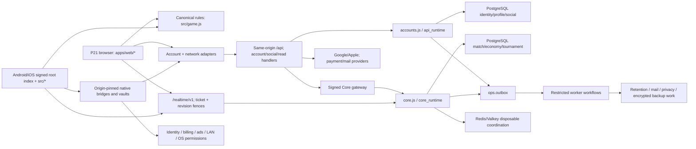

# V5.2 architecture map — Sagan workstream

Audit source: `codex@7f582b749a1128b86e53ddcbcda57b569b0953cf`, PR #30 → V5.2. Date: 2026-10-17. Canonical production origin, by owner contract: **https://megaxo.online**. This is a source/CI evidence map, not a live deployment inventory or the final launch verdict.

The shared checkout advanced during this audit. The generator reads immutable Git blobs from the requested audit commit, not the moving working tree. Concurrent source changes and other specialists' files were not modified. GitNexus listed no index for this repository; no index was created because it would write outside this workstream's allowlist. Source extraction is the documented fallback.

## Deliverable and provenance

- 98 semantic feature records, 37 website routes and 87 platform-specific mobile screen/state rows.
- 748 scanned source/config/test files, 3,175 graph nodes and 8,167 directed evidence edges.
- Source content digest: `afcea0873696d8d3e5e64767b1fba2c69940f8958d16c9e1351d0cc40ee867a3`.
- Node JSON and edge JSON carry the exact source commit, digest, extraction method, types and counts.
- Every node has a real source path, line and symbol/declaration anchor. Every edge carries a source path, line and evidence basis. File/module anchors use line 1; a module anchor is not an assertion about an individual function body.
- [Offline graph viewer](graph-viewer/index.html): one HTML file, embedded JSON/CSS/vanilla JavaScript, no CDN, imports, fetch, font download or runtime dependency. Search by feature, path, endpoint, table or symbol; filter types/relationships; inspect incoming/outgoing neighbors; export JSON. A keyboard-accessible relationship list accompanies the SVG.

## Runtime map



This overview expresses ownership and composition, not a claim that each arrow was exercised live. The full machine graph records its more limited literal/declaration evidence.

| Layer | Source anchors | Responsibility / boundary |
| --- | --- | --- |
| Website packaging | `scripts/p21/build-web.js:20` `WEBSITE_ROUTES`; `apps/web/index.html`; `apps/web/app.js` | Explicit public route/build allowlist; prerendered shell plus browser modules. `/game` is the website renderer, not the native app UI. |
| Retained/native UI | `index.html`; `src/app.js`; `src/community.js`; `src/party-ui.js`; `src/monetization-ui.js` | Full app screens and local practice saves. Native bundles inject native transport metadata. Retained browser entry is packaged under `/legacy-game/`. |
| Native bundle/host | `native/client/bundle.config.json`; `scripts/v5/build-client-bundle.cjs`; Android `MegaXOActivity.kt`; iOS `MegaXOApplication.swift` | Signed local assets, platform navigation, safe areas, SDK integration and credential ownership. `scripts/v5/serve-client-review.cjs` is a loopback review server, not production. |
| Rules | `src/game.js:7-19`, `create/legal/apply/step` | Single canonical move legality, route, mini-board and Mega-board transitions. Search optimizations must remain differential equivalents. |
| Local AI | `src/bot/runtime.js`; `worker.js`; `contracts.js`; `search.js`; `pack.js`; `local-ai.js` | Seeded/budgeted client-first search; game/revision fences; explicit fallback labels; no account/economic authority. Empty approved neural catalog. |
| Tutorial | `src/tutorial/lesson.js`; `client.js`; `apps/web/bot-compat.js` | Versioned six-move teaching state machine; explicit Continue and Beginner handoff. Unverified/unpaid. |
| Transport | `src/account-client.js`; `src/network.js`; `apps/web/realtime.js`; native API/session/vault adapters | Cookie+CSRF browser lane; credential-isolated native lane; ticketed realtime and stale-session/revision rejection. |
| API composition | `apps/api/index.js`; `apps/api/routes/*`; `scripts/v51/v5-production-server.cjs:682,947` | Account service and callbacks are composed over PostgreSQL in the production server. Source composition, not a read-only VPS observation. |
| Account authority | `packages/services/accounts.js`; `packages/db/pg/accounts.js`; migration `0039_api_service_reads.sql` | Actor/identity/session/profile/social ownership; narrow owner-created secret-read functions; canonical auth lock ordering. No API economy grants. |
| Competitive/economic authority | `packages/services/core.js`; `core-gateway.js`; `queue.js`; `tournaments.js`; `apps/game-core/*` | Only Core settles competitive/economic mutations. Signed ingress, immutable terms, operation keys, escrow/occupancy and offer deadlines are preserved. |
| Provider/commerce | `server/identity-provider.js`; `packages/services/commerce*.js`; `cashfree.js`; `polar.js`; `provider-workflows.js` | Verified subject identity, receipt/webhook verification, account-bound purchases and refunds. Code presence is not merchant/store approval. |
| Worker/maintenance | `apps/worker/index.js`; `packages/services/jobs.js`; `worker-workflows.js`; `maintenance-scheduler.js` | Durable job/outbox processing, retries, privacy/retention/mail and maintenance ownership; not ad-hoc API work with Core credentials. |
| Migration/recovery | `packages/migrations/*`; backup/recovery modules under `packages/` and `scripts/v5/` | Separate migrator and backup roles; immutable recovery evidence; PostgreSQL remains authoritative after application writes. Legacy SQLite is not a recovery writer. |

## Data and state boundaries

The graph includes 97 SQL **declaration** table nodes. This is not a production relation count: it includes migration/rehearsal namespaces and does not establish which migrations are installed live.

- Identity: `identity.actors`, `eligibility`, `identities`, `email_credentials`, `signin_attempts`, `sessions`, refresh families/tokens, tickets and signing keys.
- Account/social: `identity.profiles`, `profile.profile_saves`, `social.friendships`, `friend_requests`, `blocks`, privacy requests/reports.
- Economic/competitive: `economy.wallets`, ledger/operations, ratings, season state/history; `match.matches`, participants and escrow; tournament rooms/fixtures/escrow; season payout tables.
- Commerce: receipts, store bindings, notifications/revocations, provider orders/subscriptions, pass periods, reward ticket/event accounting.
- Operations/research: `ops.outbox`, rate buckets, runtime controls, consent/capture/retention/suppression tables and deletion receipts.

Browser/native local state is separate: `mega_v32_state`, device power bank/cadence, owner-scoped practice archives, website practice state, native vaults and disposable presence coordination. Reading a linked wallet for display does not make a device-local debit authoritative. SAGAN-009 records the resulting power-purchase wallet UX issue for the economy owner.

## Critical cross-layer gaps

1. **SAGAN-002:** `src/community.js` → `/api/account/decision*` → `server/community-http.js` → SQLite `CommunityStore` is implemented. The authoritative PostgreSQL account service and route manifest have no equivalent decision transition. `createWebSignInLane` assumes a completed session. Production account-choice parity is not established by the SQLite tests.
2. **SAGAN-004:** the legacy confirmation promises cancellation; source has scheduling/sweeping but no cancellation action, route or store operation.
3. **SAGAN-012:** guest native sessions use compiled provider capabilities; linked sessions replace them with linked identity names and mark all as supported. The distinction between an account binding and a host adapter is lost.
4. **SAGAN-003:** the website account CTA navigates to `/game`, but that shell does not load `src/community.js` or open the app's security controls.
5. Website power presentation is intentionally fail-closed: `board.js:353` supplies no verified binding; `powers.js:58` defaults the integration gate to false. Native Bot powers and browser presentation are different implementation surfaces.

## Graph model and interpretation

| Type | Count | Interpretation |
| --- | ---: | --- |
| Feature | 98 | Curated product slices and explicitly absent contracted behavior |
| Screen | 124 | 37 website routes + 87 platform-specific app/system screen states |
| UI Component | 52 | UI modules/host adapters, not all runtime DOM instances |
| Button | 581 | Unique source declaration/helper call-site records; includes fields/disclosures/navigation under the requested interaction-node type |
| State Store / Hook | 23 / 59 | Source storage-key sites / event listener declarations |
| Service / API Endpoint / Backend Handler | 35 / 89 / 117 | Service modules; 86 manifest entries plus 3 legacy-only decision endpoints; handler modules/functions |
| DB Table / Job / External Provider | 97 / 15 / 10 | SQL declarations / kind references / adapters; not live resources |
| Config-Flag / Test / Utility | 314 / 303 / 1,258 | Source config sites, test/helper files and utility modules/functions |

All requested node and edge vocabularies are supported. `CALLS` can mean a literal dispatcher/endpoint reference; `DEPENDS_ON` can mean an import, UMD reference or explicitly curated implementation association. Their basis is in each edge. `TESTED_BY` denotes a test definition/import/reference, not an execution or coverage result. `AUTHORIZES` records the manifest's auth contract, not a new security proof.

The extractor does not resolve arbitrary dynamic imports, generated selectors, all lexical scopes, reflection, native SDK internals, worker `importScripts` expressions or deployed provider configuration. Regex references can include declarations/comments; high-impact claims in the reports were separately read in source. Dynamic templates are inventoried as control families rather than fabricated runtime instances. No zero-edge result proves isolation.

## Regeneration

From the repository root:

```sh
node scripts/audit/generate-architecture-graph.cjs --ref=7f582b749a1128b86e53ddcbcda57b569b0953cf
```

Omitting `--ref` selects that same pinned audit commit, even when HEAD has advanced. The generator reads `git ls-tree`, `git cat-file --batch` and immutable blobs, never application modules or secrets. It does not run tests, build apps, start services or modify git. Stable IDs, code-point sorting and omission of timestamps keep output deterministic.

It rewrites only the three feature inventory files, five machine graph/viewer files and five UI CSVs listed in its explicit allowlist: **13 generated files**. The architecture/change-impact/UI/gameplay reports and findings CSV are manually reviewed deliverables and are not overwritten. `--ref=<other commit>` is available for structural regeneration; feature verdicts and CI links remain curated baseline assessments and must be re-reviewed before certifying another commit.

Verification performed: generator syntax checking, regeneration, JSON/CSV/XML/reference checks, embedded viewer-script syntax checking and repeat-generation checksum comparison. These are artifact integrity checks, not local product tests. No browser/device acceptance was performed by this workstream.
