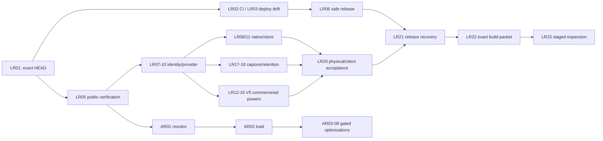

# Mega XOXO V5.2 — final open work, dependency order and production verdict

**As-of:** 2026-10-16 review of `V5.2` at `1bbed3669dd9fee1ce7af9d7a699fed0d728456a`. **Status:** read-only evidence audit, not a new release or cutover authorization. New technical architecture plan: [HLD/LLD and performance review](../architecture/PRODUCTION-HLD-LLD-AND-PERFORMANCE-REVIEW-20261016.md). Main is actively merging other work, so this is a **PR proposed for V5.2**, not a direct trunk commit.

## Executive status: distinguish live product from launch completeness

| Area | Current verdict | Evidence / qualification |
| --- | --- | --- |
| **Web game on megaxo.online** | **LIVE (last proven 2026-10-15)** | Oracle/Caddy + V5.2 Node/PG. 31/31 public two-account online acceptance recorded after apex DNS transfer. October 16 reviewer HTTP access DNS-blocked, so no fresh live response assertion. |
| **Production DB authority** | **CUT OVER; single writer** | PostgreSQL 16/Neon, 55 migrations; V4 SQLite writer fenced. First production write/epoch recorded. PG forward-fix recovery only; no second SQLite writer. |
| **Core match/currencies** | **OPERATIONAL, LIMITED REAL COHORT** | Core/queues/wallet/ledger and backups/alerts tested. Only two actual actors in early cutover data; no realistic public-scale capacity benchmark or host HA. |
| **Website visual/tutorial acceptance** | **OWNER ACCEPTED** | No repeat novice study or aesthetic blocking. Technical cross-platform/auth, live UX and regressions are distinct requirements. |
| **Native apps** | **DEVELOPMENT-BUILD DEVICE VERIFIED; STORES NOT RELEASED** | OnePlus Android and signed dev iPhone launched; final production app IDs, provider sign-in, stable iOS distribution chain, fresh store artifacts/submissions still needed. |
| **Login/auth** | **PARTIAL / MOVING** | PR #17 web OAuth source landed; PR #18 provider sign-in availability and iOS signing open; Oct15 real Google/Apple auth unavailable; prove live roundtrip. |
| **Undo/hint UI** | **PARTLY DEVICE VERIFIED** | UI exists on Android and same bundled client on iOS. Live earned AdMob rewarded ad, PvP counter protocol, banked settlement and provider SSV not proven. |
| **Monetization** | **NOT READY TO ENABLE** | V5 `/api/monetization/*` absent at audited HEAD; PR #19 Cashfree changes legacy V4 handler with a separate documented V5 PG/Core integration backlog. Provider approval and financial verification required. |
| **Research capture** | **STAGING VERIFIED, LIVE RESEARCH SCOPE UNPROVEN** | Migrations 0052–0055 and account research routes tested; no live production policy/export/pruning proof supplied. Gate `productionAuthorized:false` is not a day-one corpus PASS. |
| **CI / release reliability** | **RED** | At exact head, 12/14 workflows green, 2 failed; roots are old-origin CORS/CSRF assertions and iOS simulator ID launch. Need corrected exact merged SHA. |
| **Architecture capacity** | **UNMEASURED AT SCALE** | Existing P15/P16/P19 disposable tests exercise correctness and small tiers, not 64k active sockets; single Node process and Oracle host remain failure domain. |
| **Vercel auxiliary deployment** | **API READY; commercial role needs review** | Canonical game apex currently on Oracle. Separate Vercel API web projects on Hobby; signed Core origin and canonical domain attachments need reconciliation; Hobby cannot be assumed suitable for paid commerce. |

**Overall:** live beta/gameplay = **yes**. Unrestricted public acquisition = **not yet validated** (global `noindex` source). New exact-SHA release = **blocked by CI failures**. Android/iOS store release = **pending provider/signing/review**. Rewarded powers/payments = **disabled or unverified**. 64k-connection scalable/host HA = **not substantiated**.

## 0. Preserve completed work (do not regress or relaunch cutover)

- V5.2 is the actual **default branch**. `V5.1` is frozen historical, `V4.1` preserved for recovery, `main` is represented by `archive/main-pre-retirement-20261014` tag; no merge back into V4 or pre-retirement main. The earlier feat/fix branches were deleted after ancestry checks, not missing work.
- Prior V4→PG migration and live authority transfer **are done**. This plan never repeats E4/E5 or treats PG as non-serving. A new PG migration is additive/forward-compatible, with tested backup and rollback plan. **Caddy's inherited V4 Compose definition must not restart its fenced SQLite app; LR03A addresses this concrete source-level risk.**
- Last Oct15 apex acceptance and owner-approved website visuals, tutorial, branding and four native/fifth browser themes are acknowledged. Change only broken/current features.
- The previous 24-item V5.1 plan is **historic**; this is the new V5.2 incremental worklist, not 24 outstanding old migration tasks.
- Respect the owner's no-payment rule: no fee, upgrade, paid tier or actual purchase without explicit authorization. No personal phone data deletion/reset. Game rules/economy, rewards unaffected by Undo, Coins/Crowns unchanged; Impossible UI remains hidden while unqualified.

## 1. Dependency-ordered worklist

### Stage A — fix the exact live source and CI (parallel, before any new rollout)

| ID | Priority / state | Required action and *done when* | Lead | Dependencies |
| --- | --- | --- | --- | --- |
| **LR01** | **P0 OPEN / active trunk** | Inventory newest `V5.2` SHA after Main merges PRs #18/#19; check PR diff and history. Establish one exact source, current host artifact, provider deployment IDs, migrations, feature flags, current operator CI. Do not change live writers during read-only audit. | Main + WebUI | none |
| **LR02** | **P0 CI FAILED** | Repair obsolete CORS/CSRF expectations from retired host, *not* loosen origin handling. Test expected 403 error-code/payload; update iOS simulator install/launch using actual build product bundle identifier. Rerun all 14 required workflow families on exact merge head and require green. | Main + WebUI | LR01 |
| **LR03** | **P0 config drift, historical 502** | Separate immutable deployment artifact from mutable production epoch/`serving` state. Test repeating deployment when repo inventory says `nonserving:true` and host is authorized `false`, with backup, replay and fail-closed detection. No automatic V4 restart. | Main | LR01 |
| **LR03A** | **P0 LATENT WRITER RISK** | **Retire dangerous V4-era Docker Compose dependency:** `deploy/compose.yaml` still declares SQLite `app restart:unless-stopped` and `edge.depends_on.app:service_healthy`. Create a dedicated V5 edge-only orchestration definition; dry-run/render test that Caddy updates *cannot re-create V4 app* or touch its SQLite volume. Preserve V4 Compose only in explicit isolated recovery archives. **Do not test `docker compose up` on the live host.** | Main | LR01, LR03 |
| **LR04** | **P0 SOURCE RISK** | Outside-in verify actual `X-Robots-Tag` on homepage/game, robots, sitemap and canonical links. Source sets global `noindex` in production server; correct intended public pages, retain noindex for staging, private and auth responses. Test status/redirect 200/301/308, Caddy headers and 404 paths. | Codex + Main | LR01 |
| **LR05** | **P0 live health** | Probe `megaxo.online` full page assets, `/livez`, `/readyz`, `/opsz`, account and public match routes, signed Core edge 401 unsigned, host TLS/cert; compare SHA with live deployed bundle and check backup freshness, alerts, restart drills. Record actual observation time; source read ≠ HTTP pass. | Main + Codex | LR01 |
| **LR06** | **P0 deployment protection** | Ensure branch protection/required CI, immutable digest and env/source drift checks, V4 fence and PG epoch verification in deploy; correct Vercel domain assignment and remove obsolete duplicate authority assumptions. Preserve rollback/forward recovery. | Main + Codex | LR02–LR05 |

### Stage B — identity, client launch and service integration

| ID | Priority / state | Action and proof | Lead | Dependencies |
| --- | --- | --- | --- | --- |
| **LR07** | **P0 PARTIAL** | Review then integrate PR #18 after Main resolves overlapping edits; configure approved Google/Apple OAuth, P05 native bearer continuity, real browser→Android→iOS same permanent actor. Verify cookies/PKCE/state/nonce, logout/revocation, CSRF, no forged headers, session expiry. | Main + Codex | LR01, LR02 |
| **LR08** | **P0 PARTIAL** | Audit permanent app IDs `online.megaxo.xoxo` vs existing Apple/Play records and upload cert, iOS actual registered team/certs and entitlements; produce fresh reproducible signed AAB/IPA/TestFlight build with no devtest identifier in release. Test on owner's phone *without deleting personal data*. | Codex + Main | LR07 |
| **LR09** | **P0 AUXILIARY RISK** | Trace `Vercel API→Core` through exact **canonical** production HTTPS/HMAC path, check Host/redirect/replay; refuse `core.megaxo.online` until its stale staging pointer is eliminated. Resolve whether the two Vercel projects are needed now; if used for commerce, confirm non-Hobby commercial eligibility without buying a tier. | Codex + Main | LR05 |
| **LR10** | **P0 PARTIAL** | Verify Resend actual enabled V5 signup/verify/reset/change, one-use challenges, eventual worker delivery and failed delivery; current source inventory says `outbound.email=disabled`. Provider dashboard historical delivery is not V5 proof. | Main + Codex | LR05, LR07 |
| **LR11** | **P0 ACTUAL STORES NOT SUBMITTED** | Create/update store app records, final title/assets, age/audience/privacy/deletion declarations, in-app links, screenshots, sandbox SKUs, refunds/restores; submit supported actual release builds to review and record upload/submission/review/approved separately. Accounts themselves are already approved. | Codex + Main | LR08, LR10, LR14, LR18 |

### Stage C — powers, ads, payment and research data (independent subtracks)

| ID | Priority / state | Action and proof | Lead | Dependencies |
| --- | --- | --- | --- | --- |
| **LR12** | **P0 ENABLEMENT GAP** | **V5 monetization only:** mount `apps/api/routes/monetization.js`, signed `Core commerce` methods and AdMob SSV route on canonical origin; validate typed reward item/unit, body-bound signatures, uniqueness, delays, 10/day shared cap, no duplicate grant and no Core DB privileges in API. Keep live rewards OFF until real provider earned/SSV/UMP proof. | Main | LR05, LR07 |
| **LR13** | **P0 PR #19 REVIEW** | **Cashfree:** preserve useful provider adapter/tests, but do not enable or merge as complete V5 functionality while it writes legacy V4 SQLite. Implement independent PG `commerce.cashfree_orders` and Core verified order/refund fulfillment, idempotent webhook/status; compare real gateway amount/currency before grant. KYC/category/owner payment consent separate. | Main + Codex | LR12, LR01 |
| **LR14** | **P0 POWER BEHAVIOR** | Audit all shipped Bot 2-charge Undo; Casual Undo and Undo Block, Tactical Expert highlight and separate Hint Block inventories/limits, one-success undo per match, 3 initiations, 2 valid blocks, banked powers, exactly-once, timeouts, disconnects, opponent notification and no ranked/tournament powers. Preserve normal game rewards. Add actual cross-device same-game acceptance; don’t equate visible UI to full server behavior. | Main + Codex | LR07, LR12 (for live earned use) |
| **LR15** | **P0 STORE/CONSENT** | Confirm real AdMob app review, correctly named rewarded units/SSV callback, UMP/ATT/age treatment, remove-ads entitlement only suppresses forced ads, no involuntary tutorial/match ads. Separate cosmetic rewards from Undo/power rewards; test cancel/no-fill/retry. | Codex + Main | LR11–LR12, LR14 |
| **LR16** | **P0 CASHFREE/POLAR CONDITIONAL** | Finalize approved Cashfree India category/VCIP and (if desired) Polar global/ Paddle fallback with written product eligibility; preserve Crowns only as in-game utility. Do not take payment or create charged plan without owner permission; disallow purchases until PG/Core/provider tests complete. | Codex + Human + Main | LR13, LR11 |
| **LR17** | **P0 CONSENT / CAPTURE UNVERIFIED** | Inspect **live** `learning.policy`, one-time `/api/account/research` user interface/actor consent, age/guardian restrictions and erasure; verify collection for human online, tournaments, Bot paths, immutable undo/hint revision lineages, source classification and no training on day one. Do not claim that staging synthetic capture is real user corpus. | Main + Codex | LR05, LR07 |
| **LR18** | **P0 RETENTION / DR** | Real production encrypted R2/Neon restore including privacy journal, 35-day backup prune enablement **only after safe proof** and approved retention; enforce capture 730d adult maximum/annual review, export ≤90d and local spool ≤7d where applicable. Query expiry/quarantine, consent withdrawal, export revocation and resurrected-data refusal. | Main | LR17 |
| **LR19** | **P1 TELEMETRY POLICY** | Implement minimal optional privacy-respecting metrics for real ads, verified outcome and user experience. Do not call skill score IQ, infer age/gender, profile minors with ad response or join optional research with commercial ad targeting. | Main + Codex | LR15, LR17 |

### Stage D — quality gates for expanding production and store release

| ID | Priority / state | Required proof | Lead | Dependencies |
| --- | --- | --- | --- | --- |
| **LR20** | **P0 acceptance** | Exact-SHA live browser and Android/iOS account, queue/match, wallet/friends/tournament, board/4 themes, 320px/safe-area, power counters, disconnect/reconnect, error banner and accessibility. Owner accepted website look/tutorial; no repeat aesthetic review or novice study. | Main + Codex + Human | LR07–LR18 applicable |
| **LR21** | **P0 reliability** | Revalidate /opsz, outbox/Redis loss, PG stall/PITR/R2 retrieval, forward-fix previous V5 artifact, authentication rotation, alerts and isolated restore. No V4 writer. | Main | LR03, LR18, LR20 |
| **LR22** | **P0 release packet** | Assemble independent evidence against exact merge SHA/source+image+schema/host flags/CI and genuine live services; don’t rely solely on P22 `CLAIMED_COMPLETE_UNVERIFIED`. Review open PR #18/#19 merge impact and signed artifacts. Publish source and deploy receipts, rollback, incidents and limitations. | Main + WebUI | LR01–LR21 mandatory |
| **LR23** | **P0 rollout verification** | Under existing authorized launch framework: staged app/web deploy and store submission only with gate success, verify live server after, keep previous PG-compatible artifact, freeze V4 fence and monitor first real users. Do not re-run the original PG cutover. | Main + Codex | LR22 |

### Stage E — measured architecture optimization (not an arbitrary release blocker)

| ID | Rank | Work / acceptance | Lead | Depends |
| --- | --- | --- | --- | --- |
| **AR01** | **P1 / 1st** | Instrument HTTP/WS and Node event-loop, RUM, DB pool waits/SQL, Redis RTT, per-request p95/p99, CPU/RSS and kernel sockets; record real Oracle/Neon/Aiven regions. | Main | LR05, LR06 |
| **AR02** | **P1 / 2nd** | Construct disposable realistic PG16/Redis authenticated-load and chaos harness; separate idle connections from active games, authenticated RPS, moves/sec and end-to-end turn ack, preserve economy invariants. | Main + WebUI | AR01 |
| **AR03** | **P1 / 3rd** | If telemetry proves cross-region DB/Valkey or pool checkout cost, optimize calls/indexes/pool sizes with a reproducible A/B. Data migration/cost only by owner permission. | Main | AR01–AR02 |
| **AR04** | **P1 / 4th** | Separate worker/outbox/matchmaker from main HTTP/WS event loop with durable leases and single-run ownership; confirm process failure does not duplicate wallets or timers. | Main | AR02 |
| **AR05** | **P1 / 5th** | Bound realtime socket concurrency, frame/backpressure queues, heartbeat and snapshot fanout; slow-consumer tests with flat safe memory, retries and verified snapshots. | Main | AR02 |
| **AR06** | **P2 / 6th** | Same-origin static bundle offload/Caddy immutable assets, no public caching of private/CSRF/ledger content; release hash/ETag/SW regression. | Main + Codex | AR01–AR02 |
| **AR07** | **P2 / 7th** | Multi-Core process failure testing on same host; reserve independent-host HA as a measured, cost-approved scaling stage. | Main | AR04–AR05 |
| **AR08** | **P3 research** | Rust/io_uring *socket transport only* experiment, no rewrite of canonical game/economy authority. Proceed only when benchmark isolates Node/Caddy socket CPU/memory as the dominant limit. | Main + WebUI | AR01–AR05 |

## 2. Critical path and parallel delivery

**Don't serialize independent noncommercial load-instrumentation behind app review.** Conversely, keep unapproved ad/purchase channels disabled rather than misreport them as usable or blocking already-working free gameplay.

## 3. Owner decisions already binding

1. Mega XOXO brand, current game rules, bought/earned Crown utility, browser Neon and four native themes unchanged.
2. User accepts website look/tutorial. Sol handles new power UI; functional regression still required.
3. Google Play and Apple developer accounts approved under `contact@antimatterinnovations.com`; account availability does not equal app signing/review.
4. The intended teen/general audience and research consent constraints remain; child demographic/ad profiling is not inferred from gameplay permissions.
5. Day-one training-ready collection purpose accepted, but no day-one neural training, hidden unqualified Impossible UI, actual user choices/retention still mandatory.
6. Bot Undo ad grants up to 2 choices; 10/day aggregate rewarded cap across benefits, ordinary Bot payout unchanged. Casual counters/Tactical Expert suggestions separated, matching frozen rules.
7. **No payment, paid tier, paid upgrade, overages, or personal device destructive operation without explicit owner consent**. Test accounts/isolated stacks by default.
8. V4 was already cut over/fenced; no new request to stop it, no return to SQLite. Existing operator authorization never overrides a red applicable gate.
9. Vercel Hobby is a **noncommercial** plan under https://vercel.com/legal/terms. Determine an eligible arrangement before enabling monetized use on those projects; don't auto-purchase Pro.
10. PR #18/#19 are independent ongoing Main/Codex work; avoid competing writes in their files and obtain exact merge-head acceptance.

## 4. Audit reference and unresolved observation requests

Principal Oct15 receipts: `docs/v5.2/release/{CUTOVER-EVENT-20261015,DOMAIN-CUTOVER-MEGAXO-ONLINE-20261015,FINAL-REPORT-V52-20261015,BACKEND-AND-RELIABILITY-AUDIT-20261015,DEVICE-TEST-REPORT-20261015,CONSENT-ACCOUNT-LANE-20261015,VERCEL-TAKEOVER-CORE-CONNECTIVITY-20261015}.md`. CI exact-head logs: V5 P11 test CORS/CSRF old-origin mismatches; V5.2 iOS CI FBSOpenApplicationServiceErrorDomain(4) launching prototype ID. Current provider project evidence: Vercel API READY, web domain attached; no direct Oct16 HTTP proof in audit environment. Separate PR #19 handoff explicitly says its legacy V4 Cashfree path is not the currently serving V5 monetization route.

Before changing paid plans, adding providers, changing DNS/PG region, enabling ads or deleting backups, agents must present an exact proposed action and obtain appropriate permission. Do not alter production for optimization testing without an independent safe test-environment plan.
